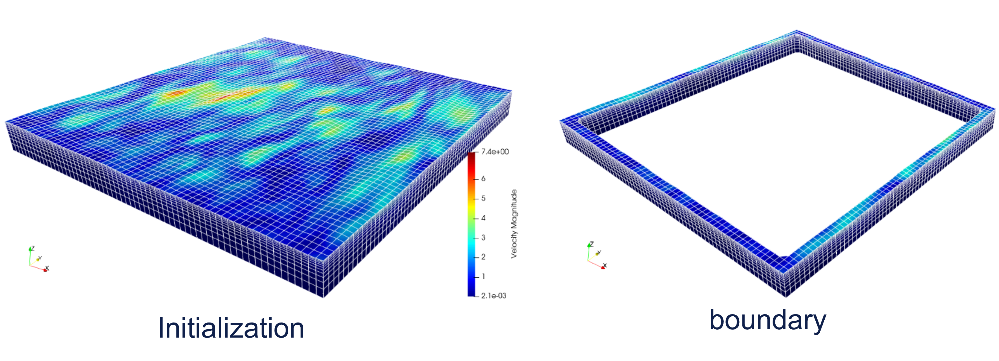

# CFDwavemaker

Wave-kinematics library for initialising CFD domains (or feeding CFD boundaries) with
consistent wave fields. It returns surface elevation, velocity, and pressure at any
point in space and time, from a range of wave theories, and is built for fast
initialisation of large domains.

<p align="center">
  
</p>
<p align="center"><em>The two ways to use CFDwavemaker: initialise the entire CFD domain with wave kinematics (left), or feed kinematics continuously at the domain boundaries (right).</em></p>

The code supports **OpenMP** (shared-memory parallelism) and, optionally, **MPI**
(distributed grid computation), and has several special features for fast
initialisation of large domains built in.

A full user manual is available as a compiled PDF, attached to the latest
[GitHub release](https://github.com/oystelan/CFDwavemaker/releases/latest)
(named `CFDwavemaker_manual_<version>.pdf` among the release assets).
The LaTeX source lives in [`CFDwavemaker_manual/`](CFDwavemaker_manual/).

## Input file

The library is configured through a single ASCII input file, always named
`waveinput.dat`, read from the working directory at `wave_Initialize()`. All
keywords and their definitions are documented in the user manual (see above).

For irregular waves, the companion tool
[**WaveForge**](https://github.com/oystelan/waveforge) provides a graphical
interface for setting up the wave spectrum and generating the `waveinput.dat`
file, with live 3-D preview of the resulting sea state:

<p align="center">
  <a href="https://github.com/oystelan/waveforge">
    
    
  </a>
</p>

## Citing

If you use CFDwavemaker in your work, please cite the
[OMAE 2022 paper](https://asmedigitalcollection.asme.org/OMAE/proceedings/OMAE2022/85925/V007T08A002/1147999):

> Lande, Ø., & Helmers, J. B. (2022). *CFDwavemaker: An Open-Source Library for
> Efficient Generation of Higher Order Wave Kinematics.* In Proceedings of the
> ASME 2022 41st International Conference on Ocean, Offshore and Arctic
> Engineering (OMAE2022), Vol. 7, V007T08A002. ASME.

```bibtex
@inproceedings{lande2022cfdwavemaker,
  title        = {CFDwavemaker: An Open-Source Library for Efficient Generation of Higher Order Wave Kinematics},
  author       = {Lande, {\O}ystein and Helmers, Jens Bloch},
  booktitle    = {International Conference on Offshore Mechanics and Arctic Engineering},
  volume       = {85925},
  pages        = {V007T08A002},
  year         = {2022},
  organization = {American Society of Mechanical Engineers}
}
```

## Supported wave theories

- **Linear** wave theory (irregular & short-crested waves)
- **Second-order** wave theory (Sharma & Dean, with Taylor expansion above z = 0) —
  irregular & short-crested waves
- **Stokes 5th-order** regular waves (long-crested)
- **Stream-function** (Fenton / Rienecker & Fenton) steady regular waves — accurate for
  steep and shallow-water waves where Stokes theory breaks down
- **Wave-maker** theory (piston-type), reading paddle motion from an input file
  (long-crested)
- **Spectral-Wave-Data (SWD)** — extension for reading higher-order spectral method
  (HOSM) kinematics via the open [SWD library](https://github.com/SpectralWaveData/spectral_wave_data)
- **VTK kinematics** — read kinematics stored in VTK (`.vts`) format from other CFD
  solvers, including multilayer Lagrangian output (per-layer thickness `h`,
  non-hydrostatic pressure `phi`)

## Outputs

- Surface elevation at any position (x, y)
- Velocity components (ux, uy, uz)
- Dynamic and non-hydrostatic pressure
- Volume fraction (for VOF initialisation)
- Seabed elevation

## Special features

- **Grid interpolation** of wave kinematics (Lagrangian stretched s-grid with 4-D cubic
  spline interpolation) for much faster initialisation when using second-order
  kinematics — far fewer expensive second-order evaluations are needed for an accurate
  field.
- **MPI-distributed grid computation**: the second-order s-grid kinematics can be
  computed collectively across MPI ranks (work-balanced column partition +
  `MPI_Allgatherv`), so every rank ends up with the full updated field. See the manual
  (section *Distributed grid computation with MPI*).

## Linking / usage

The library is called through a small `extern "C"` API (see
[`src/CFDwavemaker.h`](src/CFDwavemaker.h)): initialise once with `wave_Initialize()`
(reads `waveinput.dat` from the working directory), then query points with
`wave_VeloX/Y/Z`, `wave_SurfElev`, `wave_DynPres`, etc.

- **C / C++ / Basilisk / OpenFOAM**: link the static or shared library and include
  `CFDwavemaker.h`.
- **Python**: load the shared library with `ctypes`. A ready-to-use wrapper is provided
  in [`examples/python/cfdwavemaker.py`](examples/python/cfdwavemaker.py), and the
  manual's *Link to Python* section documents the full binding.

Worked examples for each theory live in [`examples/python/`](examples/python/).

## Build instructions

1. Navigate into the folder `src/`.
2. Run `make` — the OpenMP version of CFDwavemaker will be built. Alternatively provide
   a specific build target:
   - `make` or `make default` — the default build (`libCFDwavemaker_openmp`: core
     kinematics library + the SWD extension, OpenMP-parallel).
   - `make mpi` (via `make_mpi.mk`) — the MPI build (`libCFDwavemaker_mpi`; uses
     `mpicxx`, `-DMPI_enable=1`; OpenMP is disabled in this build — it is either/or).
     The host CFD owns `MPI_Init`/`MPI_Finalize`; the library only uses the existing
     communicator.
   - `make vtk` — the complete library, including the VTK extension. This requires that
     the VTK library has been installed and compiled, and that the makefiles are updated
     for the VTK version you have installed. A bit involved to link, so stay away from
     this unless you need it.

   Every target cleans and rebuilds automatically (the targets use different compiler
   flags), and the libraries land in `builds/linux64/`.

## Version log (highlights only)

### Version 3.7.13
- **Clean re-initialization**: a second `wave_Initialize()` in the same process
  no longer fails with a spurious "duplicate [wave type] section" error, and no
  settings (extrapolation method, ramps) leak from the previous run — the full
  input parse state is reset at every initialization, carrying across only the
  documented pre-init overrides (`wave_SetLsgridBounds/Borders/BorderMargin`).
- Test inputs modernised (`border_*` selection replaces the removed
  `ignore_subdomain`); all 12 test scripts pass on the openmp and mpi builds.

### Version 3.7.12
- **Dynamic pressure as a fourth lsgrid field** (`store_pressure 0/1/auto`):
  `wave_nhPres()`/`wave_DynPres()` are served by spline interpolation at full
  second order — the incident non-hydrostatic pressure a generating-absorbing
  boundary condition subtracts. `auto` enables the field for border-mode grids
  (the GABC case) and disables it for full-domain initialization grids. Filled
  by all three fill paths, sigma-FFT included (collocation-exact against
  pointwise evaluation).

### Version 3.7.11
- `wave_nhPres()` had no case for the lsgrid wave types and silently returned
  0, so a GABC subtracting the incident non-hydrostatic pressure
  over-generated (measured +14–20% on Hs). It now serves the first-order
  p_nh by direct summation on those paths (superseded by the full
  second-order grid field in 3.7.12).

### Version 3.7.10
- **Automatic layer count**: `nl` may be omitted from `[lsgrid]` (or given as
  `nl auto`) — the smallest layer count whose vertical reconstruction of the
  sea-state RMS velocity profile meets `nl_tol` (default 2e-4) is picked at
  initialization, each candidate count evaluated at its own optimal grading.
  Together with the derived `nx`/`ny`/`dt` and `stretch_beta auto`, the whole
  grid discretisation now follows from the loaded sea state.

### Version 3.7.9
- **Parallel sigma-FFT fill** (OpenMP + MPI): the per-time-level fill was
  serial, and under MPI every rank recomputed it redundantly — the dominant
  scaling term on large lattices. The pair binning, the inverse FFTs and the
  layer loop are now parallel; MPI ranks sum blocks of the pair list and own
  layers round-robin.

### Version 3.7.8
- **Rank-0 seabed load + broadcast**: a large bathymetry mesh is parsed,
  welded and finalized on rank 0 only and broadcast in compact form (the
  concurrent per-rank load surged node memory at init and OOM-killed high
  rank counts). Queries are byte-identical to a local load.
- New `wave_SeabedRelease()`: in geometry-only mode the solver can free the
  mesh once it has imported its bathymetry and init fields.

### Version 3.7.7
- Rank-divergent lsgrid errors print from the failing rank with a rank
  prefix (previously muted by master-only logging, so a tripped guard killed
  the whole job with no message).

### Version 3.7.6
- **`ignore_subdomain` is removed**, replaced by naming the borders that need
  kinematics. `ignore_subdomain` specifies the complement, in absolute metres, so
  it has to be re-derived whenever the CFD grid changes — and when it is a
  little too tight the symptom is a boundary that misbehaves for no visible
  reason. The `[lsgrid]` section now accepts
  `border_left / border_right / border_bottom / border_top` (0/1): a strip
  along the named borders is stored and the interior is dropped; with none
  selected the whole grid is kept, which is what a solver initialising its
  full domain wants. An input file still containing `ignore_subdomain` is
  rejected with a message pointing at the replacement — silently ignoring it
  would restore full-domain storage with no visible symptom.
  On a 257x257x10 grid feeding one border: **1285 of 66049 nodes, 51x less
  memory** (the hand-tuned ignore box on the same case managed 26x).
- **`equal_dk` now implies `vertical_theory smit`.** The sigma-FFT fills the
  grid with the smit sigma-transform, so Sharma & Dean would not match the
  field that ends up stored — smit is the only consistent choice on that
  path. Requiring the keyword therefore only created a way to silently lose
  the fast path and fall back to direct summation (a very slow init, with
  nothing in the log pointing at the cause). It is now defaulted, and stating
  `vertical_theory sharma` explicitly still overrides it.
- **`wave_SetBorderMargin(metres)`** lets the solver declare how far *inward*
  it will ask for kinematics, so the stored strip is sized in metres rather
  than grid nodes. Without it the strip is a fixed node count, which silently
  stops being enough once the client's cells are coarse relative to the node
  spacing — a coarse CFD run over a finely resolved wave lattice. The
  condition is `Delta_client <= 6*dx`; with the margin declared it cannot be
  violated. For a Basilisk multilayer GABC the reach is `Delta/2` (the
  boundary face plus the first interior cell centre, which the
  outgoing-residual decomposition needs).
- **The grid extent must come from exactly one place, and can come from the
  solver.** `bounds` in `[lsgrid]` is now optional, but if neither it nor
  `wave_SetLsgridBounds()` is given the library stops with an error rather
  than building a zero-extent grid. Setting it from the solver avoids
  duplicating the domain in two places where they drift apart:
  `wave_SetLsgridBounds(xmin, xmax, ymin, ymax)` and
  `wave_SetLsgridBorders(left, right, bottom, top)`. Both must be called
  before `wave_Initialize()` (the grid is built during init) and return 0
  without acting if called later; both override the input file.
- **`nx`, `ny` and `dt` are now optional everywhere.** The grid only has to
  resolve the field it stores, and the components describe that field
  completely, so it can size itself: the shortest wave present sets the node
  spacing and the shortest period sets the time step, at `points_per_wave`
  points each (default 6). Under the sigma-FFT the lattice is taken from the
  component set exactly, as before; on the other paths - variable bathymetry,
  non-equal-dk components, SWD - the spacing is derived. For SWD the file's
  own spectral resolution (`n`, `dk`) is queried, falling back on the
  elevation DFT if the shape does not define them.
  Cubic Hermite converges at fourth order, so the choice is cheap to reason
  about - measured velocity error against a converged reference: **1.7% at 4
  points, 0.5% at 6, 0.14% at 8**. Since border storage already cuts the grid
  to a few per cent of the domain, the default errs toward accuracy. Only
  `nl` still has to be stated.
- **The grid reports what it actually resolved to**, for QA: `nx x ny x nl`
  over the bounds with the resulting **dx, dy and dt** in metres/seconds
  (derived or not, these were never visible before), and how far the stored
  border strip reaches into the domain in metres - which is what a linked
  solver has to compare against its own stencil reach.
- **The sigma-FFT now reports whether the node spacing resolves the spectrum**
  — points per shortest first-order and second-order wavelength. The lattice
  size is set by the Nyquist requirement for the second-order sum bins, which
  is *not* the same as resolving them for interpolation, and the difference is
  invisible otherwise. Reported rather than silently refined — the lattice
  follows the component set, so the place to change it is the generator.
- Verified: kinematics bit-identical to the dense grid across the retained
  border strips in both `ignore_at_init` modes, MPI `np=1` == `np=4`, and the
  svenner case end-to-end.

### Version 3.7.5
- **`ignore_subdomain` now reduces MEMORY, which is what it was always
  worth.** The lsgrid arrays were sized `4*nx*ny*nl` regardless of the ignore
  box on every path — the mask only ever skipped *computation* — so a run
  feeding a boundary strip paid full-domain storage, replicated on every MPI
  rank. Field access now goes through a storage-node map (`slot[]`,
  `nid(i,j)`) instead of the dense `i*ny + j`, and `compact()` drops the
  nodes the ignore box covers.
  - Kept is the retained region plus a **three-node halo**: one ring because
    the gather in `square_vals`/`cube_vals` reads the far corner `(i+1, j+1)`
    of the query cell, a second because those corner nodes must carry valid
    finite-difference gradients, and a third as margin so the
    gradient-*valid* region reaches two full nodes past the retained region
    rather than ending on its edge. Note the halo lies *inside* the ignore
    box and must still be filled, so fills are gated on `fill_node()`
    (storage), not on `IGNORE` (computation).
  - The query guard tests `grad_ok()` on all four corners, not just that
    they are stored: the Hermite blend reads the precomputed gradients, and
    a corner on the outermost kept ring has dropped neighbours, so its slope
    is meaningless. Checking storage alone would let a query through and
    interpolate silently with a garbage gradient.
  - `ignore_at_init 1`: compaction runs before the first fill, so the large
    arrays are never allocated. `ignore_at_init 0`: the whole grid is filled
    at t = 0 — a solver initialising its full domain needs that — and the
    memory is handed back on the first time advance.
  - Querying a dropped node is now a hard error naming the point, instead of
    silently reading uninitialised memory (which is what `ignore_at_init 1`
    already did before this change).
  - The MPI gather gained `allgather_columns_var()` for the variable
    per-column counts; slots are assigned i-major so each rank's column range
    stays contiguous.
  - Verified bit-identical: 980 sampled kinematics through the refactor with
    the map as identity, and 384 samples across the retained region with
    compaction on (both `ignore_at_init` modes), covering `wave_SurfElev`,
    `wave_VeloX/Y/Z`, the Hermite blend and the precomputed gradients. MPI
    `np=1` vs `np=4` byte-identical on both the sigma-FFT and the
    direct-summation path (the latter is what exercises the new gather).
  - On a 257x257x10 lsgrid feeding a boundary strip: **2040 of 66049 nodes
    kept, 32x less memory** (~228 MB -> ~7 MB per rank).

### Version 3.7.4
- **Two startup messages lied in geometry-only mode.** With `[seabed]
  kinematics 0` the init log claimed "Second order: depth-local Sharma & Dean"
  and warned "vertical_theory smit is ignored with [seabed]". Both describe
  the *active*-bathymetry kinematics and were printed whenever a surface was
  merely loaded, contradicting the "Seabed kinematics OFF (geometry-only)"
  line directly above them. In geometry-only mode the second order is the
  ordinary constant-depth Sharma & Dean and `smit` is honoured in full — as
  it must be, since the sigma-FFT path requires `vertical_theory == 1` and
  refuses to run with active bathymetry at all. Messages moved inside the
  active branch; the geometry-only line now states that the requested
  vertical theory is used.
- **`ignore_subdomain` now says what it does on the sigma-FFT path: nothing.**
  An FFT produces the whole lattice in a single transform, so the ignore box
  cannot skip work there (it does save work on the direct-summation path).
  The log now reports how many lsgrid nodes the ignore box covers, how many
  lie between it and the lsgrid bounds, and that all of them are filled
  regardless — previously the box simply appeared to be disregarded.

### Version 3.7.3
- **A linked solver can now validate its domain against the bathymetry.**
  Depth queries beyond the edge of the `[seabed]` mesh are not an error — they
  clamp to the nearest mesh point, so the bed quietly becomes a flat,
  zero-slope skirt. At a solver's domain edge that is a boundary condition
  applied to a bed that does not exist, and it presents as an immediate drain
  of the boundary columns, which is expensive to diagnose after the fact. New
  `wave_SeabedBounds()` (footprint bbox), `wave_SeabedContains(x, y)` (exact
  point-in-footprint test, no clamping and no warning) and
  `wave_SeabedOutsideCount()` (how many queries were clamped) let the solver
  refuse to start instead.
- The existing out-of-footprint warning fired once per run through a bare
  `printf`, so it escaped both basilisk's per-rank stdout redirection and the
  master-only logging added in 3.7.1 — it printed from every rank, once, and
  then went silent. It now goes through `cfdwm_mpi::err()` and every
  subsequent occurrence is counted rather than dropped.
- **sigma-FFT reports its coverage**, and states explicitly that it does not
  read the bathymetry: the setup log now gives how many of the FFT lattice
  nodes fall inside the requested lsgrid window, and the constant depth in
  use. (The FFT path is bathymetry-free by construction —
  `try_sigma_fft_setup()` bails when `seabed.active()`, `local_depth()` falls
  back to the constant `water_depth` otherwise, and `sigma_fft.cpp` contains
  no reference to the seabed at all. A window covering only a fraction of the
  period is the usual sign of lsgrid bounds that do not match the CFD domain.)

### Version 3.7.2
- **Depth queries are local wherever a `[seabed]` surface exists.** New
  `wave_LocalDepth(x, y)` returns the local still-water depth from the
  `[seabed]` surface whenever one is loaded — whatever generates the
  kinematics (direct summation, lsgrid / sigma-FFT, …) and including
  geometry-only mode (`[seabed] kinematics 0`) — and falls back to the
  constant `depth` from `[general input data]` only when no surface is given.
  Unclamped, so land comes back negative, consistent with `wave_SeabedRaw()`.
  `wave_PhaseVelocity()` now shares this accessor instead of repeating the
  lookup.
- **Layer grading at the local depth.** `wave_OptimalLayerRatio()` only ever
  answered for the reference depth, so a linked layered solver could not vary
  its layer distribution with the bathymetry. `wave_OptimalLayerRatioAtDepth
  (nlayers, depth)` and `wave_OptimalLayerRatioAt(nlayers, x, y)` evaluate the
  same optimiser at an arbitrary depth: each component keeps its frequency
  (wavenumber from the local dispersion relation) and its energy flux
  (Green's law for the amplitude), reproducing the stored set exactly at the
  reference depth. One evaluation is ~10^7 flops, so the depth dependence is
  tabulated once per `nlayers` (48 log-spaced depths) and interpolated —
  cheap enough to call per grid column. `wave_OptimalLayerRatio()` is
  unchanged in behaviour.

### Version 3.7.1
- **Master-only startup log**: every MPI rank reads `waveinput.dat` and used to
  echo the full input summary, multiplying it by the rank count and making
  SLURM job logs unusable. The banner, the input summary and the warnings are
  now written by rank 0 only (`cfdwm_mpi::out()`/`err()`), so the log is flat
  in rank count. Hard errors (unparseable input, missing file) still print on
  every rank, prefixed `[rank N]` - a file missing on one node only is exactly
  what master-only logging must not hide.
- Three fatal input-file paths (version check, unknown wave type) called bare
  `exit()`, which leaves the other ranks deadlocked in the next collective;
  they now go through the `MPI_Abort` path like the rest.

### Version 3.7.0
- **sigma-FFT lsgrid window**: the lsgrid no longer stores one full spatial
  period. Bounds are sized to the CFD domain (plus ghost margin); the grid is
  snapped to the FFT nodes inside them (spacing pinned to `L/nfft`, every
  stored value an exact collocation value of the second-order solution), for
  typically 10-30x less memory and spline work. Bounds covering a full period
  still lock to one periodic tile. `ignore_subdomain` composes with the
  window for boundary-only updates after initialization.
- **New `[wave input irregular]` component format**: 4 columns per row -
  `OMEGA A PHASE THETA`, or `K A PHASE THETA` with `equal_dk 1` (the lattice
  is exact in k; the secondary quantity follows from the dispersion relation,
  so the redundant column is gone). Legacy 5-column files still read, with a
  deprecation note. **Double summation (`ndir > 0`) is removed** - every
  component carries its own direction; `ndir 0` is tolerated and ignored.
  WaveForge >= 1.5 writes the new format.

### Version 3.2.0
- **Variable bathymetry (`[seabed]`)**: the seabed can be given as a triangulated
  surface file (STL ascii/binary or OBJ, easily exported from ParaView/Blender/CAD).
  Irregular-wave kinematics then switch to a **slope-corrected first-order theory**
  (modified vertical eigenfunction with the directional bed slope) that satisfies the
  sloping-bottom boundary condition *exactly*, plus **depth-local Sharma & Dean second
  order** (interaction coefficients evaluated at the local depth, with the interaction
  limit on sum interactions). Works with direct evaluation and with the lsgrid (layers
  follow the local depth per column). Includes a minimum-depth limit, vertical datum
  shift and horizontal positioning (`xshift`/`yshift`, e.g. for UTM meshes), and
  `wave_Seabed(x, y)` returns the local bed level.
- **Smit s-coordinate second-order kinematics** (`vertical_theory smit`): corrected and
  fully validated implementation of the sigma-transformed second-order theory
  (Smit et al. 2017) — exponential velocity profiles all the way to the instantaneous
  free surface with no kink at z = 0, exact Eulerian mapping for w, v and pressure.
  Validated by an epsilon-scaling program (third-order convergence against Sharma &
  Dean below the trough; surface BC closure for mono, bichromatic, crossing and
  irregular seas).
- **Sigma-layer FFT evaluation**: for component sets on an equal-dk wavenumber grid
  (long-crested) or a 2D wave-vector lattice (short-crested), the lsgrid time levels
  are filled with FFTs instead of pointwise sums — exact at the grid nodes and orders
  of magnitude faster. The grid locks to the spatial period(s), making the field
  perfectly periodic: queries outside the domain wrap around. Wave input files with
  this structure are generated by [WaveForge](https://github.com/oystelan/waveforge)
  (`equal_dk 1`), including the mean-direction folding for short-crested lattices.
- **Exponential layer stretching** for the lsgrid. The old two-parameter
  `stretch_params` is replaced by a single intuitive `stretch_beta` (geometric layer
  thickness progression). From v3.3.0 the default is `stretch_beta auto`, which at
  initialization picks the stretching that minimizes the vertical interpolation
  error for the loaded sea state. Deep water stretches toward the surface and
  shallow water relaxes toward uniform layers (the legacy fixed beta=3 was a factor
  ~13 *worse* than uniform layers at kh≈0.5). A numeric `stretch_beta <value>`
  keeps the manual behaviour. With SWD input there is no component set, so auto
  falls back to the numeric default.
- The wavenumber column of the component table is now always recomputed from omega
  through the dispersion relation (with a warning if the file disagrees — usually a
  depth mismatch).
- **MPI build validated with the seabed/lsgrid path**: the grid fill distributes
  across ranks (work-balanced column partition + `MPI_Allgatherv` assembly) with
  bit-identical results for any rank count. Bathymetry probes outside the mesh
  footprint no longer slow down with distance from the edge (this destroyed the MPI
  load balance), repeated per-column probes and dispersion solves are cached, log
  output and file writers (probes, VTK, spectral dump) are limited to rank 0, and
  fatal errors call `MPI_Abort` instead of stranding the other ranks in a collective.
  Note that `wave_force_update()` is a collective call in the MPI build.
- **Input reader rewritten** (`src/input_reader.cpp`, two-phase: parse then
  resolve/initialize): the `[section]` order in `waveinput.dat` no longer matters, and
  keyword order within a section is free. Misspelled sections/keywords now warn instead
  of being silently ignored, malformed numbers are a hard error instead of silently
  becoming zero, and duplicated sections are rejected. Verified bit-identical kinematics
  across all 720 section-order permutations of an irregular+lsgrid input
  (`tests/t010_input_reader/`).
- Fixes: uninitialized legacy `sloping_bottom` flag removed; below-mudline guard now
  respects the local bed level; segfault when `[lsgrid]` was given without stretch
  parameters; manual build fixes.

### Version 3.1.0
- **Stream-function (Fenton) wave theory** added (`theory_type stream`) — validated
  against Fenton's tabulated results.
- **VTK multilayer support**: read per-layer thickness (`h`) and non-hydrostatic
  pressure (`phi`) from multilayer `.vts` output, with conservative piecewise-parabolic
  (PPR) or linear vertical reconstruction (`vertical_interp`). Faster VTK interpolation.
- **MPI support**: distribute the second-order s-grid kinematics computation across MPI
  ranks (`wave_set_mpi_comm`, work-balanced partition). Serial and MPI results are
  bit-identical.
- **Python `ctypes` wrapper** and a full LaTeX user manual.
- `[wave reference point]` shift now applied consistently on the VTK path.

### Version 3.0.1
- (major update) Added spline interpolation in 4 dimensions to LSgrid. This improves
  accuracy and smoothness of the resulting time series and improves calculation time,
  since much less second-order kinematics is needed to create an accurate description of
  the field.

### Version 2.1.6
- VTK extension.
- Minor bugfixes in second-order theory related to intermediate water-depth usage.

### Version 2.1.5
- Added probes as output, so that x, y, z coordinates may be specified to dump
  kinematics to file.
- Fixed CFDwavemaker for Windows — now compiles without SWD.
- Some cleanup of the code.

### Version 2.1.4
- Improved performance with OpenMP and irregular waves.
- Minor bug fixes.
- Added parameter `[vtk output]/timelabel` and `[lsgrid]/init_only`.

### Version 2.1.3 (highlights since version 1)
- Complete restructuring of the input file format.
- Implementation of a new Lagrangian stretched-grid interpolation scheme.
- Support for spectral wave data files (`.swd`) through the external
  [Spectral-Wave-Data](https://github.com/SpectralWaveData/spectral_wave_data) library,
  enabling higher-order spectral methods for CFD initialisation and boundaries (HOSM).
- General cleanup and removal of old leftovers.
- The entire code restructured to make use of classes; the previous Stokes C code
  converted to a C++ class.
- Fixed a large number of bugs in the original code.
